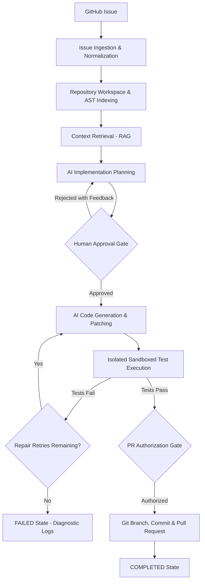

# Agentic Software Development Workflow

An autonomous software engineering system that converts GitHub issues into working, tested code changes and GitHub Pull Requests, with a mandatory human approval checkpoint.

---

## 1. Project Overview

The **Agentic Software Development Workflow** bridges the gap between issue reporting and production-grade pull requests. It ingests GitHub issues, understands the target codebase using AST-aware Retrieval-Augmented Generation (RAG), synthesizes a structured implementation plan, halts at a mandatory human approval gate, generates minimal reviewable code changes in an isolated workspace, executes automated tests in a sandboxed subprocess with bounded repair attempts, and opens a GitHub Pull Request upon explicit authorization.

### Core Workflow



---

## 2. Technology Stack

| Layer | Technology | Description |
|---|---|---|
| **Web Framework** | FastAPI (async) | High-performance, async-native API framework with automatic OpenAPI docs. |
| **Validation & Schemas** | Pydantic v2 + Pydantic Settings | Strict data validation, environment variable parsing, and JSON schema generation. |
| **Persistence & ORM** | SQLAlchemy 2.x (async) | Eager relationship loading, partial unique indexing, and async SQLite via `aiosqlite`. |
| **Code Understanding & RAG** | Python `ast` + Custom Hybrid Retriever | AST parsing for functions/classes, keyword weighting, and token-budgeted context formatting. |
| **LLM Integration** | Async HTTPX Client | Provider-independent architecture with `OpenAILLMClient` and deterministic `MockLLMClient`. |
| **Git & PR Automation** | GitHub REST API v3 + Git CLI | Branch creation, patch application, unified diff generation, and Pull Request creation. |
| **Sandboxed Execution** | Subprocess Sandbox Runner | Command whitelisting, environment secret scrubbing, and timeout protection. |
| **Testing & Quality** | Pytest + pytest-asyncio, Ruff, Mypy | 293 automated tests, 100% strict type annotations, and Ruff lint/formatting compliance. |

---

## 3. Project Structure

```text
agentic-dev-workflow/
├── app/
│   ├── adapters/         # External service clients (GitHub API, LLM providers)
│   ├── api/              # FastAPI routers, endpoints, and Pydantic schemas
│   ├── core/             # Configuration management and application settings
│   ├── db/               # SQLAlchemy models (Job, Plan, Artifact), sessions, migrations
│   ├── execution/        # Sandboxed subprocess runner, test execution, repair loop
│   ├── intelligence/     # Codebase indexing, AST parsing, chunking, RAG retriever, coder
│   ├── orchestrator/     # Persistent state machine, background tasks, crash recovery
│   ├── services/         # Business services (issue ingestion, approval, git, pull requests)
│   └── main.py           # Application factory, lifespan management, startup recovery
├── tests/
│   ├── unit/             # Unit tests for adapters, intelligence, execution, APIs, models
│   └── integration/      # End-to-end integration tests with mocked external services
├── workspaces/           # Isolated job workspaces (gitignored)
├── .env.example          # Environment variable template
└── pyproject.toml        # Dependencies, tool configurations, and test runners
```

---

## 4. Installation & Quickstart

### Prerequisites
- Python 3.11 or higher
- Git 2.30+

### 1. Clone the repository
```bash
git clone https://github.com/shriharsha-vadali/agentic-software-development-workflow.git
cd agentic-software-development-workflow
```

### 2. Set up virtual environment
```bash
python -m venv .venv

# On Windows PowerShell:
.venv\Scripts\Activate.ps1

# On Linux / macOS:
source .venv/bin/activate
```

### 3. Install dependencies
```bash
pip install -e ".[dev]"
```

### 4. Configure environment variables
Copy `.env.example` to `.env`:
```bash
cp .env.example .env
```

Configure your credentials:
```env
GITHUB_TOKEN=ghp_your_personal_access_token_here
GITHUB_API_BASE_URL=https://api.github.com
GITHUB_TIMEOUT_SECONDS=30.0

LLM_PROVIDER=openai
LLM_API_KEY=sk-your-openai-api-key-here
LLM_MODEL=gpt-4o

DATABASE_URL=sqlite+aiosqlite:///./jobs.db
LOG_LEVEL=INFO
MAX_RETRIES=3
EXECUTION_TIMEOUT_SECONDS=60.0
```
*(Note: If `LLM_API_KEY` contains placeholder text, the application automatically uses the deterministic `MockLLMClient` for offline testing.)*

### 5. Run the application
```bash
uvicorn app.main:app --reload --host 0.0.0.0 --port 8000
```
- Swagger UI Documentation: `http://localhost:8000/docs`
- ReDoc Documentation: `http://localhost:8000/redoc`

---

## 5. API Reference & Workflow Walkthrough

### 1. Ingest an Issue
```http
POST /jobs/ingest
Content-Type: application/json

{
  "issue_url": "https://github.com/octocat/Hello-World/issues/42"
}
```
*Creates Job (Status: `PENDING`), ingests issue metadata, stores `issue_data` artifact, and launches background planning.*

### 2. Inspect Job Progress & Plan
```http
GET /jobs/{id}
```
*When planning completes, the job pauses in `AWAITING_APPROVAL` with the generated `Plan` in `draft` status.*

```http
GET /jobs/{id}/plan
```
*Returns the structured implementation plan, problem statement, affected files, steps, test plan, and complexity estimate.*

### 3. Human Approval Checkpoint
#### Approve Plan:
```http
POST /jobs/{id}/approve
Content-Type: application/json

{
  "decision": "approved"
}
```
*Advances Job to `GENERATING_CODE`. Unapproved execution is strictly rejected by the server.*

#### Reject Plan (with Revision Feedback):
```http
POST /jobs/{id}/approve
Content-Type: application/json

{
  "decision": "rejected",
  "feedback": "Please use aiosqlite instead of synchronous sqlite3 and add regression tests."
}
```
*Transitions Job back to `PLANNING` for AI re-planning incorporating the human feedback.*

### 4. Execute Code Generation & Sandboxed Tests
```http
POST /jobs/{id}/execute
```
*Applies verified code modifications to the isolated workspace, saves the `diff` artifact, and executes pytest in a sandboxed subprocess. If tests fail, the bounded repair engine automatically initiates targeted fixes up to `max_retries`.*

### 5. Authorize Pull Request Submission
```http
POST /jobs/{id}/approve-pr
```
*Explicit authorization gate: checkouts dedicated feature branch `agent/issue-{num}-{id}`, commits approved changes, opens Pull Request via GitHub API, records `pr_url` artifact, and transitions Job to terminal state `COMPLETED`.*

### 6. Job Cancellation
```http
POST /jobs/{id}/cancel
```
*Cancels active in-flight tasks and cleanly transitions Job to `FAILED` with diagnostic logs.*

---

## 6. Docker Container Isolation & Security Boundaries

### Docker Execution Architecture
All generated project test suites and analysis tasks run inside disposable Docker containers by default:
- **Non-Root Execution**: Runs under unprivileged UID/GID (`--user 1000:1000`).
- **Network Isolation**: Networking is disabled by default (`--network none`) to prevent outbound data exfiltration.
- **Filesystem Lockdown**: Root filesystem is mounted read-only (`--read-only`) with a strictly sized, non-executable in-memory temporary partition (`--tmpfs /tmp:rw,noexec,nosuid,size=64m`).
- **Scoped Mounts**: Only the specific job workspace (`workspaces/job_{id}`) is mounted at `/workspace:rw`. The host filesystem is never mounted broadly.
- **Dropped Capabilities**: All Linux root capabilities are revoked (`--cap-drop ALL`, `--security-opt=no-new-privileges`).
- **Resource Constraints**: Hard limits on memory (`--memory 512m`), CPU (`--cpus 1.0`), and processes/threads (`--pids-limit 100`).
- **Timeout Cleanup**: Timed-out containers are forcefully terminated (`docker rm -f <container_name>`).
- **Credential Scrubbing**: Host credentials (`GITHUB_TOKEN`, `LLM_API_KEY`) are never passed to execution containers.

### Docker Prerequisites & Installation
1. **Linux**: Install Docker Engine via official packages (`sudo apt-get install docker-ce docker-ce-cli containerd.io`). Ensure the daemon is running (`sudo systemctl start docker`).
2. **macOS / Windows**: Install [Docker Desktop](https://www.docker.com/products/docker-desktop/) and ensure the Docker daemon is active.
3. Pre-pull the base execution image:
   ```bash
   docker pull python:3.11-slim
   ```

### Development Without Docker
If developing in an environment where Docker is unavailable, you can explicitly configure local subprocess execution. The system will **never** silently fall back to host execution:
```env
EXECUTION_BACKEND=local_subprocess
ALLOW_HOST_EXECUTION=true
```

### Core Security Principles
1. **Mandatory Human Approval Gate**: Target repository workspace files are NEVER modified before explicit human approval.
2. **Explicit PR Authorization Gate**: Pull requests are never pushed or created without explicit human authorization.
3. **Command & Image Validation**: Commands are strictly restricted to whitelisted binaries (`pytest`, `python`, `git`, `ruff`, `mypy`). Container images are validated against strict regex patterns to prevent command injection.
4. **Path Traversal Protection**: All file modifications are resolved against the job's workspace root; directory traversal attempts (`../`, absolute paths, `.git/` tampering) raise immediate exceptions.
5. **Untrusted Input Handling**: Issue titles, descriptions, and comments are treated as untrusted data and isolated within sanitized prompt blocks to prevent prompt injection.
6. **Secret Masking**: Tokens are wrapped in Pydantic's `SecretStr` and excluded from logs, exceptions, and `repr`.

---

## 7. Running Tests & Quality Verification

All 293 tests run without real GitHub credentials or paid LLM API calls using deterministic mocks:

```bash
# Run full test suite (unit + integration)
python -m pytest tests/ -v

# Run Ruff linter
python -m ruff check app/ tests/

# Run Ruff formatting verification
python -m ruff format --check app/ tests/

# Run Mypy static type checker
python -m mypy app/
```

---

## 8. License

MIT
